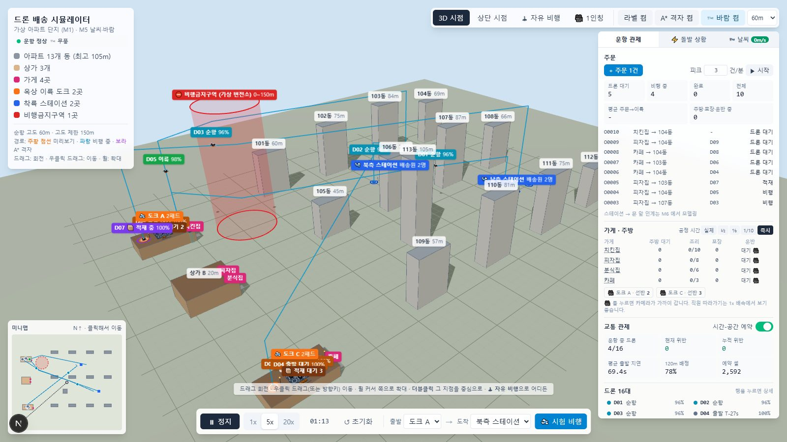

# 드론 배송 3D 시뮬레이터

도심 아파트 단지에서 드론 16대가 건물·비행금지구역·바람을 피해 음식을 배송하는 과정을 브라우저에서 3D로 시뮬레이션하고, 구간별 배송 시간과 안전 지표를 측정합니다.

**바로 실행해 보기: https://drone-delivery-sim-tau.vercel.app**



## 무엇을 하나

- **가게 → 도크**: 가게별 조리 시간·동시 조리 수·포장 인원, 직원이 엘리베이터로 옥상 도크까지 운반, 패드에서 20초 적재
- **비행**: 이륙 → 순항 → 하강 → 착륙 → 복귀 상태 머신, 속도·가속도 제한 운동 모델
- **경로 탐색**: 3D 점유 격자(5m × 5m × 10m) 위 26방향 A*, 비용 = 비행 시간, 가시성 평활화
- **충돌 회피**: 시간-공간 예약 테이블(15m 칸 × 1초), 출발 지연·방향별 고도(편도 60/120m, 복귀 90m)·패드 후보 탐색으로 이격 15m 보장
- **돌발 상황 6종**: 임시 비행금지구역, 지도에 없는 장애물, 비협조 비행체(ADS-B 유무), 배터리 급감, 통신 두절, 스테이션 폐쇄 — 원하는 시각에 주입하고 대응 정책(재경로·복귀·공중 대기·고도 회피·비상착륙·스테이션 전환)을 비교
- **바람·날씨**: 고도별 풍속(멱법칙), 돌풍, 드론별 난류, 건물 뒤 빌딩풍 구역, 비·추위·안개의 배터리·센서 영향, 운항 중단 시 라이더 전환
- **시점**: 3D 궤도, 상단, 자유 비행(WASD·QE·Shift), 드론 1인칭(HUD)

## 바람 속 안전 검증 (피크 분당 5건, 15분)

| 조건 | 배송 | 이격 위반 | 최소 간격 |
|---|---|---|---|
| 무풍 | 32~35건 | 0 | 25m |
| 6m/s, 돌풍 30% | 24~31건 | 0 | 16.3m |
| 8m/s, 돌풍 50% | 19~32건 | 2~9회 | 10~12m (충돌 없음) |

바람 속에서는 10초마다 실제 위치로 재예약, 최근접점(CPA) 기반 근접 회피, 패드 잠금을 추가로 씁니다. 8m/s 돌풍 단계에서는 15m 기준을 순간적으로 못 지키는 경우가 남아, 주의 단계에서는 이격 기준을 늘리거나 운항을 줄여야 한다는 결론입니다.

## 실행

```bash
npm install
npm run dev        # http://localhost:3000
npm test           # Vitest (106개)
npm run typecheck
npm run lint
```

## 구조

- `src/sim/` — 시뮬레이션 로직 (순수 TypeScript, React/three 의존 금지 — ESLint 로 강제)
  - `config.ts` — 모든 수치를 한 곳에서
  - `engine/SimEngine.ts` — 엔진 인터페이스 (나중에 PX4 SITL·Gazebo 로 교체 가능), `engine/LocalSimEngine.ts` — 자체 엔진
  - `flight/` 운동 모델·임무 진행, `pathfinding/` A*, `traffic/` 예약 테이블·궤적 예측, `hazards/` 돌발 상황, `wind/` 바람·날씨, `orders/` 주방·운반
- `src/data/map.json` — 단지 데이터 (ENU 좌표, m)
- `src/components/` — 3D 렌더링·UI (`coords.ts` 에서만 ENU ↔ Three.js 변환)
- `src/store/` — zustand 상태, 원클릭 시나리오

시뮬레이션은 50ms 고정 간격으로 진행하고(1·5·20배속), 화면은 보간해서 그립니다. 엔진과 궤적 예측이 같은 비행 함수를 써서 무풍에서는 예측 = 실제입니다.

## 좌표계

ENU: x = 동, y = 북, z = 위 (m). 풍향은 "불어오는" 방향, 북 = 0, 시계 방향.

## 기술 스택

Next.js (App Router) · TypeScript · React Three Fiber · drei · zustand · Tailwind CSS · Vitest · Vercel
